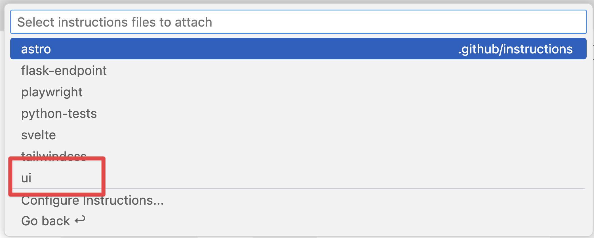

Até as atualizações mais simples de um aplicativo costumam exigir alterações em vários arquivos e operações como executar testes. Em geral, o desenvolvedor precisa localizar todos os arquivos necessários, fazer as alterações, executar os testes, depurar, descobrir qual arquivo ficou faltando e fazer outra atualização — e por aí vai.

É nesse ponto que entra o modo de agente do Copilot.

O modo de agente do Copilot foi criado para atuar com mais autonomia no IDE. Ele trabalha de forma semelhante a um desenvolvedor: começa explorando a estrutura existente do projeto, faz as atualizações necessárias, executa tarefas como testes e corrige automaticamente os problemas encontrados. Explore como usar o modo de agente para adicionar uma funcionalidade ao site.

> [!NOTE]
> O modo de agente e o agente de nuvem oferecem experiências diferentes. O modo de agente trabalha no IDE e permite ciclos rápidos de feedback. O agente de nuvem trabalha de forma assíncrona, como um integrante da equipe, e interage com você por meio de issues e pull requests.

Neste exercício, você aprenderá como:

- o modo de agente do Copilot explora o projeto, identifica arquivos relevantes e faz alterações coordenadas.
- o modo de agente do GitHub Copilot implementa funcionalidades na interface do usuário (UI) e na camada de dados.
- revisar as alterações e os testes gerados pelo modo de agente antes de mesclá-los à base de código.

## Cenário

À medida que a lista de jogos cresce, você quer permitir que usuários filtrem por categoria e editora. Você já criou um helper de editoras no exercício anterior; agora conclua o trabalho restante na camada de dados, na interface e nos testes.

## Execute o site Tailspin Toys

Antes de alterar o código, explore o site para entender o comportamento atual. O site de financiamento coletivo para jogos de tabuleiro com tema de desenvolvimento é um único aplicativo Astro, que gera HTML estático durante a compilação. As páginas consultam um banco de dados SQLite local pelo Drizzle ORM. Não há API de back-end separada nem framework de interface no cliente. Helpers de acesso a dados ficam em `src/lib/`, e a interatividade usa scripts Astro pequenos com APIs padrão do DOM.

### Inicie o site

O comando `npm run dev` inicia o servidor de desenvolvimento Astro.

1. Volte ao Codespace. Você deve estar no branch `main` após o exercício anterior.
2. Abra um terminal com <kbd>Control</kbd>+<kbd>\`</kbd> (Mac) ou <kbd>Ctrl</kbd>+<kbd>\`</kbd> (Windows/Linux).
3. Crie um branch para a filtragem:

   ```bash
   git checkout main
   git pull
   git checkout -b filtering-vscode
   ```

4. Inicie o site:

   ```bash
   npm run dev
   ```

   Quando o servidor Astro estiver pronto, você verá um banner com a URL, semelhante a:

   ```bash
   🚀 Tailspin Toys is ready!
      Astro server: http://localhost:4321
      Press Ctrl-C to stop.
   ```

> [!NOTE]
> Se aparecer uma caixa de diálogo perguntando se você quer abrir `http://localhost:4321`, feche-a selecionando **x**.

5. Abra o site mantendo pressionada a tecla <kbd>Command</kbd> (Mac) ou <kbd>Ctrl</kbd> (Windows/Linux) e selecionando `http://localhost:4321` no terminal.

> [!NOTE]
> No Codespace, o link localhost do terminal redireciona para `https://<your-codespace-name>-4321.app.github.dev/`, um túnel privado para o servidor.

### Explore o site

Os principais recursos do site são:

- **Página inicial**: exibe uma lista de jogos de tabuleiro com títulos, imagens e descrições.
- **Página de detalhes do jogo**: ao selecionar um jogo, você acessa uma página com mais informações, incluindo título, descrição, editora e categoria.

## Explore o backlog com o Copilot

> [!TIP]
> **Abra o Copilot Chat**
>
> Antes de começar os exercícios abaixo, volte ao Codespace, abra o painel Copilot Chat e selecione **New Chat** para iniciar uma conversa limpa. O modo e o modelo variam por exercício; cada etapa indica a configuração necessária.

A implementação inicial do site funciona, mas queremos adicionar recursos. Comece revisando o backlog. A criação do projeto a partir do modelo gerou automaticamente um backlog de issues; peça ao GitHub Copilot que as mostre.

1. Na lista de agentes da visualização Chat, selecione **Agent**.

   
2. Selecione **Claude Sonnet 4.5** na lista de modelos disponíveis.
3. Peça ao Copilot que mostre o backlog:

   ```plaintext
   Mostre o backlog de itens do meu repositório do GitHub. Ajude-me a priorizá-los com base no que será mais útil para o usuário.
   ```

4. Selecione **Continue** para permitir que o comando liste as issues.
5. Revise a lista gerada de issues.

Observe que o Copilot também priorizou os itens conforme o que considera mais útil para o usuário.

> [!CAUTION]
> Os autores deste workshop não estão indicando preferência por um modelo. Durante a preparação, usamos Claude Sonnet 4.5 e, por isso, o incluímos nas instruções. Esperamos que as sugestões de código sejam relativamente consistentes e proporcionem uma boa experiência. No entanto, como os modelos de linguagem grandes (LLMs) são probabilísticos, as sugestões podem diferir das indicadas no workshop. Isso é normal e esperado.

> [!NOTE]
> O Copilot pode usar um comando MCP diferente, mas ainda deve concluir a tarefa.

## Revise os arquivos de instruções

Antes da geração de código, examine `.github/instructions/ui.instructions.md`, que fornece contexto sobre como adicionar funcionalidades ao site.

1. Abra `.github/instructions/ui.instructions.md` no Codespace.
2. Observe as orientações gerais para adicionar funcionalidades: a visão geral da arquitetura, os princípios de design de componentes, testabilidade e acessibilidade e os links para instruções específicas de tipos de arquivo, incluindo Astro, Tailwind CSS e Drizzle.

> [!TIP]
> Os arquivos de instruções podem referenciar outros arquivos de instruções e arquivos do projeto. Os caminhos são relativos ao arquivo de instrução, o que permite reutilizar conteúdo e exemplos.

## Implemente a filtragem

Para concluir a filtragem, são necessárias pelo menos três atualizações distintas no aplicativo:

- adicionar ou refinar a lógica restante de filtragem na camada de dados (`src/lib/`).
- adicionar ou atualizar testes do comportamento de filtragem.
- atualizar a página de listagem de jogos para introduzir a interface de filtragem.

Além disso, os testes precisam ser executados e aprovados antes de mesclar as alterações à base de código. O modo de agente do Copilot pode realizar essas tarefas. Vamos adicionar a funcionalidade.

1. Continue a conversa atual ou selecione **New Chat**.
2. Selecione **Add Context**, **Instructions** e **ui** como o arquivo de instruções.

   

3. Confirme que **Agent** está selecionado.

   
4. Confirme que **Claude Sonnet 4.5** continua selecionado.
5. Envie este prompt:

   ```plaintext
   Atualize o site para incluir a filtragem por editora e categoria de acordo com os requisitos da issue relacionada no backlog do GitHub. Um helper de editoras já existe desde o exercício anterior; preserve e refine esse trabalho conforme necessário enquanto conclui as alterações restantes na camada de dados, na interface e nos testes. Confirme que todos os testes passam antes de concluir. O servidor já está em execução, portanto não precisa iniciá-lo.
   ```

6. Acompanhe o Copilot enquanto ele explora o projeto e localiza os arquivos relacionados à funcionalidade. Você deverá vê-lo encontrar helpers da camada de dados, a interface e os testes, depois alterar os arquivos e executar os testes.

   

7. Quando solicitado pelo Copilot, selecione **Continue** para executar os testes.

   

8. Pode haver pausas e falhas temporárias nos testes. Isso é normal: o Copilot alterna entre geração de código e testes até concluir a tarefa sem detectar erros.

   

9. Explore o código gerado para identificar possíveis problemas.
10. Volte ao navegador com o site em execução e explore a nova funcionalidade.
11. Depois de confirmar que tudo funciona e revisar o código, selecione **Keep** na janela do Copilot Chat.

> [!NOTE]
> A tarefa pode levar alguns minutos. Durante o trabalho, os botões **Keep** e **Undo** podem aparecer no editor. Aguarde a conclusão antes de decidir se aceita ou desfaz as alterações.

> [!CAUTION]
> Sempre revise o código gerado pelo Copilot ou por outras ferramentas de IA.

## Resumo e próximas etapas

Parabéns! Neste exercício, exploramos como usar o modo de agente do GitHub Copilot para adicionar recursos ao site da Tailspin Toys. Você aprendeu como:

- o modo de agente do GitHub Copilot implementa funcionalidades na interface e na camada de dados.
- o modo de agente do Copilot explora o projeto, identifica arquivos relevantes e faz alterações coordenadas.
- revisar as alterações e os testes gerados pelo modo de agente antes de mesclá-los à base de código.

Agora [teste a funcionalidade com o servidor Playwright MCP][next-lesson] e abra uma pull request.

### Exercício de exploração bônus: implemente paginação

À medida que a lista de jogos cresce, será necessário habilitar a paginação. Use as habilidades deste exercício e peça ao Copilot que atualize o site para implementá-la. Ao planejar o código, considere:

- seguir as práticas recomendadas existentes, incluindo os arquivos de instruções.
- decidir como implementar a paginação: permitir que o usuário escolha o tamanho da página ou defini-lo como fixo.
- fornecer no prompt as orientações necessárias para que o Copilot implemente a solução desejada.
- iterar com o GitHub Copilot, pedindo alterações e fornecendo contexto. Esse é o fluxo normal de trabalho com o Copilot.

## Recursos

- [Modos ask, edit e agent do Copilot: o que fazem e quando usar][choose-mode]
- [Modo de agente no VS Code][vs-code-agent-mode]

[previous-lesson]: ../1-custom-instructions/
[next-lesson]: ../3-mcp/
[choose-mode]: https://github.blog/ai-and-ml/github-copilot/copilot-ask-edit-and-agent-modes-what-they-do-and-when-to-use-them/
[vs-code-agent-mode]: https://code.visualstudio.com/docs/copilot/chat/chat-agent-mode
